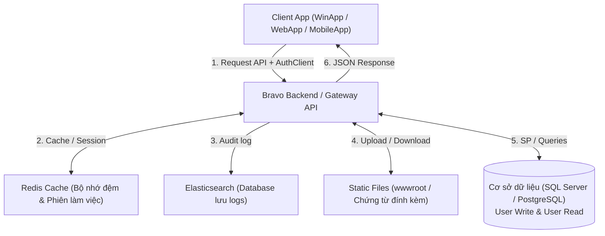
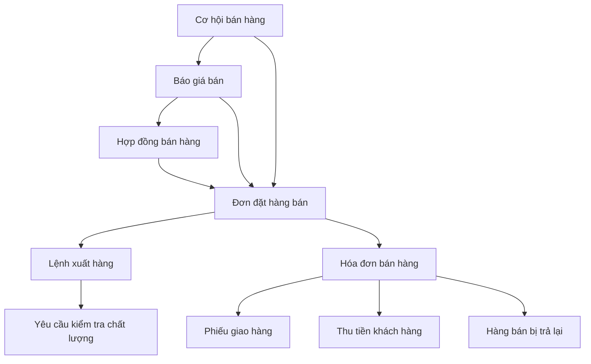

# Bravo 10 ERP Knowledge Base & Domain Specifications

This knowledge base has been reverse-engineered and extracted from the BravoGen corporate AI platform (`chat.bravogen.io.vn`), specifically tailored for AI Coding Agents and internal development.

---

## 1. Stored Procedures Inventory (`usp_*`)

The platform contains and reasons about core SQL Server and PostgreSQL stored procedures for Bravo 10:

| Stored Procedure | Business Module | Description & Functionality |
| :--- | :--- | :--- |
| `usp_B30StockLedger_Costing` | Inventory & Costing | Calculates moving average cost (`Trung bình di động`) after each receipt into `B30StockLedger`. |
| `usp_B30StockLedger_Costing_MonthlyAVG` | Inventory & Costing | Calculates periodic weighted average cost (`Bình quân gia quyền cuối kỳ`) at month-end. |
| `usp_B30StockLedger_Costing_FIFO` | Inventory & Costing | Calculates first-in, first-out inventory valuation based on purchase batches. |
| `usp_B30AccDoc_ApprovalVouchers` | Workflow & Approvals | Multi-level approval pipeline for vouchers (`BizDocId`), updating voucher status in `B30AccDoc`. |
| `usp_B30AccDoc_RePost` | Accounting Posting | Re-validates and posts general ledger vouchers to corresponding financial ledgers. |
| `usp_B30AccDocSales_ConvertFromB30BizDoc_SO` | Sales Processing | Converts approved Sales Orders (`B30BizDoc_SO`) into Sales Invoices (`B30AccDocSales`). |
| `usp_B30AccDocSales_ImportFromB30BizDoc_SO` | Sales Processing | Imports line item records from Sales Orders into invoice drafts. |
| `usp_B30PayDoc_Post` | Receivables / Payables | Posts payment vouchers and executes debt matching (`Gạch nợ / Cấn trừ công nợ hạn thanh toán`). |
| `usp_Vcd_InventoryReport` | Reporting | Generates detailed stock ledger inventory report grouped by item category or tree hierarchy. |
| `usp_IFRS_BalanceSheet_ProcessData` | Financial Reporting | Processes and compiles IFRS financial statements and balance sheets. |
| `usp_Kqt_BalanceSheet_ProcessData` | Financial Reporting | Generates standard Vietnamese accounting balance sheets from `B10Kqt*`. |
| `usp_Kqt_CashFlowStatement` | Financial Reporting | Generates indirect and direct cash flow reports. |
| `usp_sys_MergeCode` | Master Data Admin | Executes master data code merges across all foreign key tables referenced in `B00FieldList`. |
| `usp_sys_BalanceTransfer` | Year-End Closing | Transfers opening balances of accounts and inventory to the new fiscal year (`B00FiscalYear`). |

---

## 2. Core Database Schema (`B00*`, `B10*`, `B30*`)

### 2.1 System & Master Data Tables (`B00*`)
- `B00UserList`: User credentials, authentication profiles (`Checksum`, `MD5Hash`, `BranchCode`).
- `B00DMCT`: Document code catalog (`DocCode`, `TransTypeCode`, voucher prefixes, print templates).
- `B00FieldList`: Metadata registry for cascading updates when modifying or merging master keys (`usp_sys_MergeCode`).
- `B00Branch`: Corporate organizational entities / branch branches.
- `B00Config`: System parameters and global settings (e.g. `CONFIG('M_Ma_Tte0')` for base currency VND).
- `B00FiscalYear`: Fiscal years and closed accounting periods.
- `B00AuthClient`: API clients and gateway authentication credentials.

### 2.2 Financial & Reporting Tables (`B10*`)
- `B10Kqt01`: Balance sheet indicators and formula mapping.
- `B10Kqt03`: Income statement formula parameters.
- `B10Kqt0399`: Currency exchange rate and financial statement conversion flags (`ConversionFinancial`).

### 2.3 General Ledger & Inventory Tables (`B30*`)
- `B30AccDoc`: Voucher headers (Journal entries, sales invoices, payment vouchers, approval flags).
- `B30AccDocItem`: Voucher line items (Debit/Credit accounts, amount in original currency and base currency).
- `B30StockLedger`: Inventory stock card records (Warehouse, item code, quantity in/out, `UnitCost`, `Amount`).
- `B30OpenInventory`: Opening inventory balances by warehouse and item (`InventoryId`, `ItemCode`, `WarehouseId`).

---

## 3. Layout XML Engine & Evaluator Architecture

Bravo 10 uses XML Layout declarations to bind database entities to desktop/web client interfaces:

```xml
<!-- Example: BravoEvaluator with condition and currency rounding -->
<Eval_DiscountAmount>
    <ClassName>BravoMoneyEvaluator</ClassName>
    <DataMember>DiscountAmount</DataMember>
    <zResultDecimalRound>Currency('DecRound_VND')</zResultDecimalRound>
    <Value>Quantity * (OriginalUnitPrice - UnitPrice)</Value>
    <Expr>CurrencyCode = CONFIG('M_Ma_Tte0')</Expr>
</Eval_DiscountAmount>
```

### Key Evaluator Classes:
1. `BravoEvaluator`: Standard expression evaluator supporting math, logic, and conditional ternary expressions (`IIF(...)`).
2. `BravoMoneyEvaluator`: Currency-aware evaluator automatically handling decimal rounding rules (`zResultDecimalRound`).
3. `BravoServerConstraint`: Executes backend command keys (`CommandKey`) and maps return columns back into grid cells via `zSourceReturnMember`.
4. `BravoUniqueKeyValidator`: Client and server validation ensuring unique constraint on grid rows (e.g. duplicate `ItemId`).
5. `BravoLinkCommand`: Connects parent-child transactions (e.g. pulling items from delivery orders into invoices).

---

## 4. Built-in Knowledge Graph & Process Diagrams

### 4.1 Bravo Cloud Native Platform Architecture


### 4.2 Bravo Sales & Inventory Document Pipeline

